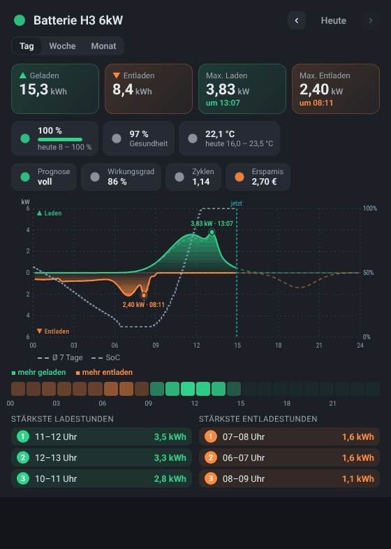
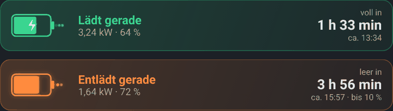
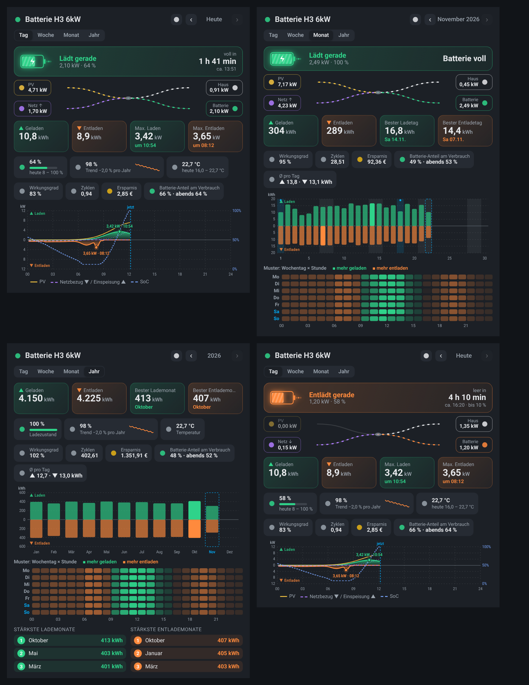
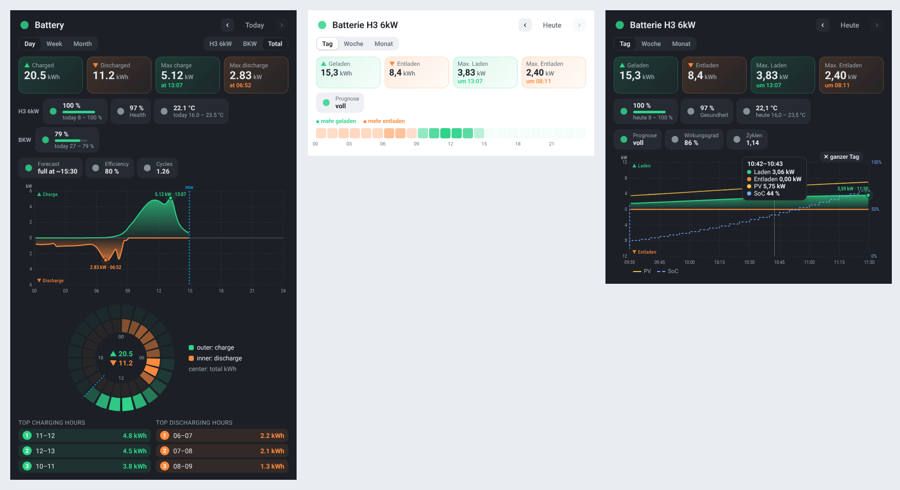

# Battery Day Card

🇬🇧 [English README](README.md) · [](https://buymeacoffee.com/muhkuh666)

Lovelace-Karte für Home Assistant, die zeigt, **wann und wie stark deine Hausbatterie geladen und entladen wurde** – pro Tag, Woche und Monat – mit Spitzen, Heatmaps, Wirkungsgrad, Zyklen, Ersparnis und „reicht bis“-Prognose.



## Funktionen

**Live-Status** – animierte Batterie zeigt **Lädt gerade / Entlädt gerade / Bereitschaft** mit aktueller Leistung und SoC, dazu **Zeit bis voll** bzw. **Zeit bis leer** (bis zur Entladegrenze) inkl. Uhrzeit. Aktualisiert sich sofort bei jeder Sensoränderung.




**Energiefluss** – Live-Mini-Grafik PV → Batterie → Haus ↔ Netz mit animierten Linien, direkt unter dem Live-Status.

**Tagesansicht**
- Gespiegeltes Diagramm: Laden nach oben, Entladen nach unten – Fläche oder Balken, mit „jetzt“-Linie und markierten Spitzen
- **Vergleichslinie**: gestern oder Ø der letzten 7 Tage (gestrichelt, zeigt auch den erwarteten Rest des Tages)
- Optional **PV**- und **Netzbezug/Einspeisung**-Linien – damit siehst du, *warum* die Batterie lädt oder entlädt
- **Zoom per Klick**: 2 Stunden in Minutenauflösung
- Heatmap in drei Stilen: **Kachelreihen**, **Netto-Band** oder **Tagesuhr** (24-h-Ring)
- Stärkste Lade- und Entladestunden

**Woche, Monat & Jahr**
- Tagesbalken (Woche/Monat) oder **Monatsbalken (Jahr)** mit Summen, Zyklen und Ersparnis; bester Tag/Monat, Top-Tage/-Monate – Klick öffnet den Zeitraum
- **Muster-Heatmap** Wochentag × Stunde (wie bei GitHub)
- **Wochenenden und Feiertage** markiert (Feiertage aus einem Kalender, z. B. Integration *Feiertage*)

**Batterie-Status & Auswertung**
- Ladezustand (SoC) mit Tagesspanne, **Gesundheit (SoH) mit Trend-Linie und Alterung pro Jahr**, **Temperatur** mit Tagesspanne
- **Batterie-Anteil am Verbrauch** – wie viel deines Hausverbrauchs die Batterie gedeckt hat, gesamt und abends/nachts
- **Netzbezug bei leerer Batterie** – Heatmap der Stunden, in denen die Batterie an der Entladegrenze war und Strom aus dem Netz kam, mit kWh, Kosten und „leer ab“-Uhrzeit; in Woche/Monat/Jahr zusätzlich, an wie vielen Tagen die Batterie leer war und ab wann im Schnitt (Option `show_empty_grid`, braucht Netz- und SoC-Sensor)
- **Wirkungsgrad** (SoC-korrigiert), **Vollzyklen**, **Ersparnis** (fester Preis oder Preissensor, z. B. Tibber), **Prognose** („reicht bis ca. 23:40“ / „voll um ca. 14:50“)

**Außerdem**
- **Mehrere Batterien** mit Tabs und **Gesamt**-Ansicht
- Zwei Sensoren **oder** ein Leistungssensor mit Vorzeichen; Leistung (W/kW) oder Energie (Wh/kWh) – automatisch erkannt
- **Kompakt-Layout** für Handy und Seitenleisten
- **Deutsch & Englisch**, folgt der HA-Sprache
- Farbschema **Dunkel / Hell / Automatisch**, alle Farben wählbar
- **Als Bild speichern** – die Karte als PNG exportieren (z. B. für Foren)
- **Alles im grafischen Editor einstellbar** – Antippen von Kennzahlen oder Status-Chips öffnet die Detailansicht des Sensors




## Benachrichtigungs-Blueprint

Push-Meldung aufs Handy, wenn die Batterie **voll** ist, die **Entladegrenze** erreicht, **zu warm** wird oder die **Gesundheit (SoH)** unter einen Grenzwert fällt – mit optionaler Ruhezeit.

[](https://my.home-assistant.io/redirect/blueprint_import/?blueprint_url=https%3A%2F%2Fraw.githubusercontent.com%2Fmuhkuh666%2Fbattery-day-card%2Fmain%2Fblueprints%2Fautomation%2Fmuhkuh666%2Fbattery_notifications.yaml)

## Installation

### HACS
1. HACS → ⋮ → *Benutzerdefinierte Repositories*
2. `https://github.com/muhkuh666/battery-day-card` mit Typ **Dashboard** hinzufügen
3. **Battery Day Card** installieren und Browser neu laden

### Manuell
1. `battery-day-card.js` nach `/config/www/` kopieren
2. Einstellungen → Dashboards → Ressourcen → `/local/battery-day-card.js` als **JavaScript-Modul**

## Konfiguration

Am einfachsten über den grafischen Editor: *Karte hinzufügen → Battery Day Card*. Passende Batterie-Sensoren werden automatisch gefunden.

```yaml
type: custom:battery-day-card
title: Batterie H3 6kW
charge_entity: sensor.h3_6kw_battery_charge
discharge_entity: sensor.h3_6kw_battery_discharge
soc_entity: sensor.h3_6kw_battery_soc
soh_entity: sensor.h3_6kw_battery_soh
temp_entity: sensor.h3_6kw_battery_temp
capacity_kwh: 10.4
min_soc: 10
pv_entity: sensor.pv_leistung
grid_entity: sensor.netz_leistung
load_entity: sensor.hausverbrauch
holiday_calendar: calendar.feiertage
price: 0.32
compare: avg7
heatmap_style: net
theme: dark
# zweite Batterie (optional)
batteries:
  - name: BKW
    mode: combined
    power_entity: sensor.bkw_batterie_leistung
    soc_entity: sensor.bkw_batterie_soc
    capacity_kwh: 2.2
```

Alle Optionen mit Standardwerten stehen in der [englischen README](README.md#options) – die Namen sind identisch, im Editor sind sie deutsch beschriftet.

## So wird gerechnet

- **Tagesansicht**: aus der Recorder-Historie; die Kurve zeigt die mittlere Leistung je Zeitabschnitt, „Max.“ den höchsten Einzelwert.
- **Woche/Monat und Vergleichslinie**: aus der Lang-/Kurzzeitstatistik von Home Assistant. Die Sensoren brauchen dafür eine `state_class` (`measurement` oder `total_increasing`) – das liefern praktisch alle Wechselrichter-Integrationen.
- **Wirkungsgrad** = (Entladen + Zunahme der gespeicherten Energie laut SoC) ÷ Geladen. Ohne Kapazität/SoC: Entladen ÷ Geladen.
- **Zyklen** = (Geladen + Entladen) ÷ 2 ÷ Kapazität.
- **Ersparnis** = entladene Energie × Strompreis der jeweiligen Stunde.
- **Batterie-Anteil** = von der Batterie gelieferte Energie ÷ Hausverbrauch (stündlich, höchstens der Verbrauch). Ohne `load_entity` wird der Verbrauch aus PV + Netz + Batterie berechnet; Abendfenster über `evening_start` / `evening_end` (Standard 18–6 Uhr).
- **SoH-Trend** = lineare Regression über die Wochenmittel der letzten ~13 Monate.
- **Zeit bis voll / leer**: aktuelle Batterieleistung, geglättet mit dem Mittel der letzten 15 Minuten, aktueller SoC und nutzbare Kapazität (bis zur Entladegrenze `min_soc`). Neue Optionen: `show_live`, `live_animation`.

## Unterstützung

Wenn dir die Karte gefällt, gib dem Repository einen ⭐ – Fehler und Ideen gerne in den [Issues](https://github.com/muhkuh666/battery-day-card/issues).

Wenn dir die Karte Geld spart, kannst du mir gern einen Kaffee spendieren ☕:

[](https://buymeacoffee.com/muhkuh666)

☕ [Muhkuh666](https://buymeacoffee.com/muhkuh666)

## Lizenz

[MIT](https://raw.githubusercontent.com/muhkuh666/helios-compass-card/v1.12.0/LICENSE) © muhkuh666
