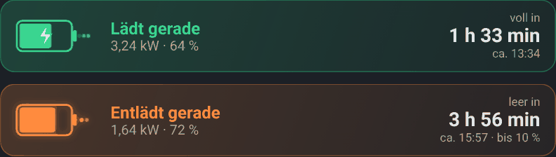
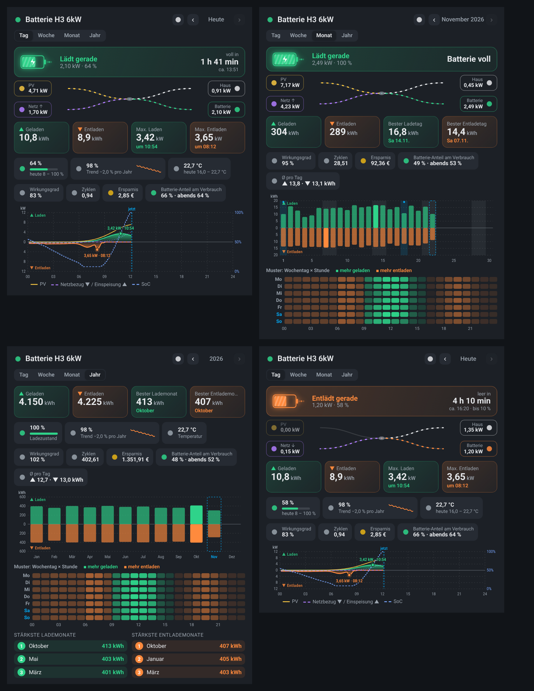
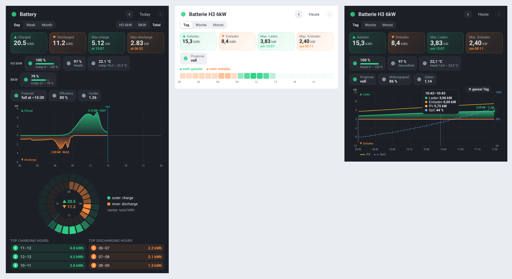

# Battery Day Card

[](https://hacs.xyz/docs/faq/custom_repositories)
[](https://github.com/muhkuh666/battery-day-card/actions/workflows/validate.yml)
[](https://github.com/muhkuh666/battery-day-card/releases)
[](https://buymeacoffee.com/muhkuh666)

🇩🇪 [Deutsche Anleitung](README.de.md)

A Lovelace card for Home Assistant that shows **when and how strongly your home battery was charged and discharged** – per day, week and month – with peaks, heatmaps, efficiency, cycles, savings and a "lasts until" forecast.


## Features

**Live status** – animated battery shows **charging / discharging / standby** with current power and SoC, plus **time until full** or **time until empty** (down to your discharge limit) incl. clock time. Updates instantly with every sensor change.




**Energy flow** – live mini graphic PV → battery → home ↔ grid with animated lines, next to the live status.

**Day view**
- Mirrored chart: charging up, discharging down – area or bars, with "now" line and marked peaks
- **Comparison line**: yesterday or Ø of the last 7 days (dashed, also shows the expected rest of today)
- Optional **PV** and **grid import/export** lines to see *why* the battery charges or discharges
- **Click to zoom**: 2 hours at 1‑minute resolution
- Heatmap in three styles: **tile rows**, **net band** or **day clock** (24 h ring)
- Top charging / discharging hours

**Week, month & year view**
- Daily bars (week/month) or **monthly bars (year)** with totals, cycles and savings; best day/month, top days/months – click to drill down
- **Pattern heatmap** weekday × hour (GitHub‑style)
- **Weekends and holidays** highlighted (holidays from any calendar, e.g. the *Holiday* integration)

**Battery status & insights**
- State of charge (SoC) with today's range, **state of health (SoH) with trend sparkline and ageing per year**, **temperature** with today's range
- **Battery share of consumption** – how much of your home consumption the battery covered, overall and in the evening/night window
- **Grid import while battery empty** – heatmap of the hours when the battery was at its discharge limit and power came from the grid, with kWh, cost, "empty from" time and, for week/month/year, on how many days the battery ran empty and the average time it did
- **Efficiency** (SoC‑corrected), **full cycles**, **savings** (fixed price or price sensor, e.g. Tibber), **forecast** ("lasts until ~23:40" / "full at ~14:50")

**Everything else**
- **Multiple batteries** with tabs and a **total** view
- Two separate sensors **or** one signed power sensor; power (W/kW) or energy (Wh/kWh) – auto‑detected
- **Compact layout** for phones and side panels
- **German & English**, follows your Home Assistant language
- **Dark / light / automatic** color scheme, all colors selectable
- **Save as image** – export the card as PNG (e.g. for forums)
- **Everything configurable in the visual editor** – tap any key figure or status chip to open the entity's details




## Notifications blueprint

Get push notifications on your phone when the battery is **full**, reaches the **discharge limit**, gets **too hot** or its **health (SoH)** drops below a limit – with optional quiet hours.

[](https://my.home-assistant.io/redirect/blueprint_import/?blueprint_url=https%3A%2F%2Fraw.githubusercontent.com%2Fmuhkuh666%2Fbattery-day-card%2Fmain%2Fblueprints%2Fautomation%2Fmuhkuh666%2Fbattery_notifications.yaml)

## Installation

### HACS
1. HACS → ⋮ → *Custom repositories*
2. Add `https://github.com/muhkuh666/battery-day-card` with type **Dashboard**
3. Install **Battery Day Card** and reload your browser

### Manual
1. Copy `battery-day-card.js` to `/config/www/`
2. Settings → Dashboards → Resources → add `/local/battery-day-card.js` as **JavaScript module**

## Configuration

The easiest way is the visual editor: *Add card → Battery Day Card*. Matching battery sensors are detected automatically.

### Minimal
```yaml
type: custom:battery-day-card
charge_entity: sensor.battery_charge
discharge_entity: sensor.battery_discharge
```

### Full example
```yaml
type: custom:battery-day-card
title: Home battery
charge_entity: sensor.h3_6kw_battery_charge
discharge_entity: sensor.h3_6kw_battery_discharge
soc_entity: sensor.h3_6kw_battery_soc
soh_entity: sensor.h3_6kw_battery_soh
temp_entity: sensor.h3_6kw_battery_temp
capacity_kwh: 10.4
min_soc: 10
pv_entity: sensor.pv_power
grid_entity: sensor.grid_power
price_entity: sensor.electricity_price
compare: avg7
heatmap_style: net
theme: dark
```

### Second battery
```yaml
batteries:
  - name: Balcony
    mode: combined
    power_entity: sensor.balcony_battery_power
    soc_entity: sensor.balcony_battery_soc
    capacity_kwh: 2.2
```

### Options

| Option | Default | Description |
|---|---|---|
| **Battery** | | |
| `name` | – | Name of the battery (tab label) |
| `mode` | `separate` | `separate` = two sensors, `combined` = one signed power sensor |
| `charge_entity` / `discharge_entity` | – | Charge / discharge sensor (required for `separate`) |
| `power_entity` | – | Signed battery power (required for `combined`) |
| `invert` | `false` | Invert the sign (positive = discharging) |
| `soc_entity` / `soh_entity` / `temp_entity` | – | State of charge, state of health, temperature |
| `capacity_kwh` | `0` | Usable capacity – enables cycles, SoC‑corrected efficiency and forecast |
| `min_soc` | `10` | Discharge limit used by the forecast |
| `unit_mode` | `auto` | `auto`, `power` (W/kW) or `energy` (Wh/kWh meter) |
| `batteries` | – | List of further batteries with the keys above |
| **PV, grid & price** | | |
| `pv_entity` | – | PV power, drawn as a line |
| `grid_entity` | – | Grid power (+ import / − export) |
| `grid_invert` | `false` | Invert the grid sign |
| `price_entity` | – | Electricity price sensor (averaged per hour) |
| `load_entity` | – | Home consumption (power or energy). Without it, consumption is derived from PV + grid + battery |
| `evening_start` / `evening_end` | `18` / `6` | Evening/night window for the battery share |
| `holiday_calendar` | – | Calendar entity with holidays |
| `price` | `0` | Fixed price per kWh (takes precedence if > 0) |
| `currency` | `€` | Currency symbol |
| **Header & view** | | |
| `title` / `icon` | `Battery` / `mdi:home-battery` | Title and icon |
| `default_view` | `day` | `day`, `week`, `month` or `year` |
| `show_export` | `true` | Button to save the card as PNG |
| `language` | `auto` | `auto`, `de` or `en` |
| `show_header` / `show_navigation` / `show_view_switch` | `true` | Header, ‹ › navigation, day/week/month switch |
| **Chart** | | |
| `chart_type` | `area` | `area` or `bars` |
| `bucket_minutes` | `15` | Resolution: 5 / 10 / 15 / 30 / 60 |
| `chart_height` | `220` | Height in px |
| `y_max` | `0` | Fixed scale in kW (0 = auto) |
| `compare` | `none` | `none`, `yesterday` or `avg7` |
| `show_pv` / `show_grid_power` / `show_soc` | `true` | Additional lines |
| `smooth` / `show_grid` / `show_peaks` / `animate_peaks` / `show_now_line` | `true` | Chart details |
| `zoom_on_click` | `true` | Click into the day chart to zoom into 2 hours |
| **Sections** | | |
| `layout` | `full` | `full` or `compact` |
| `show_stats` / `show_status` / `show_insights` / `show_heatmap` / `show_top` | `true` | Show or hide sections |
| `show_live` | `true` | Live status with time until full / empty (needs `soc_entity` + `capacity_kwh` for the times) |
| `live_animation` | `true` | Animated battery (respects "reduce motion") |
| `show_empty_grid` | `true` | Heatmap "grid import while battery empty" (needs `grid_entity` + `soc_entity`) |
| `show_flow` | `true` | Energy flow graphic (needs `pv_entity` and/or `grid_entity`) |
| `show_soh_trend` | `true` | SoH sparkline and ageing per year (long-term statistics) |
| `highlight_weekends` | `true` | Highlight weekends and holidays in week/month view |
| `heatmap_style` | `rows` | `rows`, `net` or `clock` |
| `top_count` | `3` | Number of top entries (1–8) |
| **Colors** | | Hex (`"#2fd38a"`), RGB list or CSS variable |
| `theme` | `auto` | `auto` (HA theme), `dark`, `light` |
| `charge_color` / `discharge_color` | `#2fd38a` / `#ff8a3d` | Charge / discharge |
| `soc_color` / `now_color` / `pv_color` / `grid_color` | `#7aa7ff` / `#03a9f4` / `#f5c542` / `#b07cff` | Lines |
| **Advanced** | | |
| `refresh_minutes` | `5` | Refresh interval for the current period |

## How values are calculated

- **Day view** uses the recorder history; curves show the average power per time slot, "max" is the highest single reading.
- **Week / month view and comparison line** use Home Assistant's long‑term / short‑term statistics. The sensors need a `state_class` (`measurement` or `total_increasing`) – almost all inverter integrations provide this.
- **Efficiency** = (discharged + increase of stored energy via SoC) ÷ charged. Without capacity/SoC: discharged ÷ charged.
- **Cycles** = (charged + discharged) ÷ 2 ÷ capacity.
- **Savings** = discharged energy × electricity price of the respective hour.
- **Battery share** = energy delivered by the battery ÷ home consumption (per hour, capped at the consumption).
- **SoH trend** = linear regression over the weekly SoH averages of the last ~13 months.
- **Time until full / empty** uses the current battery power, smoothed with the average of the last 15 minutes, the current SoC and the usable capacity (down to `min_soc`).

## Support

If you like the card, please ⭐ the repository – bug reports and ideas are welcome in the [issues](https://github.com/muhkuh666/battery-day-card/issues).

If the card saves you money, you can buy me a coffee ☕:

[](https://buymeacoffee.com/muhkuh666)

☕ [Muhkuh666](https://buymeacoffee.com/muhkuh666)

## License

[MIT](https://raw.githubusercontent.com/muhkuh666/helios-compass-card/v1.12.0/LICENSE) © muhkuh666
