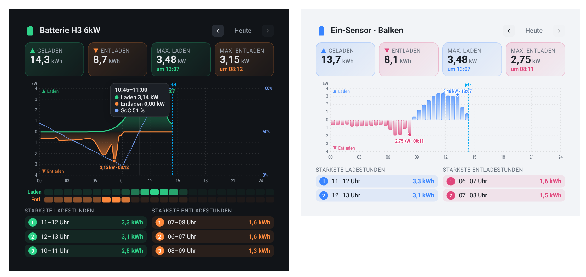

# Battery Day Card

[](https://hacs.xyz/docs/faq/custom_repositories)
[](https://github.com/muhkuh666/battery-day-card/actions/workflows/validate.yml)

Lovelace-Karte für Home Assistant, die zeigt, **wann und wie stark deine Hausbatterie über den Tag geladen und entladen wurde**.



## Funktionen

- Gespiegeltes Tagesdiagramm: Laden nach oben, Entladen nach unten – als **Fläche** oder **Balken**
- Tagessummen (kWh) und Maximalleistung mit Uhrzeit für Laden und Entladen
- Markierte Spitzen im Diagramm, Tooltip beim Darüberfahren (inkl. SoC)
- Stunden-Heatmap und Top-Stunden für Laden und Entladen
- Tage zurückblättern (‹ ›)
- Optional Ladezustand (SoC) als Linie
- **Zwei Sensoren** (Laden + Entladen) **oder ein Sensor mit Vorzeichen** (+ Laden / − Entladen)
- Leistungs- (W/kW) und Energiesensoren (Wh/kWh), automatisch erkannt
- **Alles im grafischen Editor einstellbar** – mit Farbwählern und aufklappbaren Bereichen
- Passt sich hellem und dunklem Theme an

## Installation

### HACS (benutzerdefiniertes Repository)
1. HACS → ⋮ → *Benutzerdefinierte Repositories*
2. URL `https://github.com/muhkuh666/battery-day-card`, Typ **Dashboard**
3. „Battery Day Card“ installieren und den Browser neu laden

### Manuell
1. `battery-day-card.js` nach `/config/www/` kopieren
2. Einstellungen → Dashboards → Ressourcen → `/local/battery-day-card.js` als **JavaScript-Modul**

## Konfiguration

Am einfachsten über den grafischen Editor: Karte hinzufügen → „Battery Day Card“.

### Beispiel: zwei Sensoren
```yaml
type: custom:battery-day-card
title: Batterie H3 6kW
charge_entity: sensor.h3_6kw_battery_charge
discharge_entity: sensor.h3_6kw_battery_discharge
soc_entity: sensor.h3_6kw_battery_soc
```

### Beispiel: ein Sensor mit Vorzeichen, Balken
```yaml
type: custom:battery-day-card
mode: combined
power_entity: sensor.battery_power
invert: false
chart_type: bars
bucket_minutes: 30
charge_color: "#3884ff"
discharge_color: "#e0457b"
```

### Alle Optionen

| Option | Standard | Beschreibung |
|---|---|---|
| **Sensoren** | | |
| `mode` | `separate` | `separate` = zwei Sensoren, `combined` = ein Sensor mit Vorzeichen |
| `charge_entity` | – | Sensor Laden (bei `separate`, Pflicht) |
| `discharge_entity` | – | Sensor Entladen (bei `separate`, Pflicht) |
| `power_entity` | – | Batterie-Leistung mit Vorzeichen (bei `combined`, Pflicht) |
| `invert` | `false` | Vorzeichen umkehren (positiv = Entladen) |
| `soc_entity` | – | Ladezustand in % (optional) |
| `unit_mode` | `auto` | `auto`, `power` (W/kW) oder `energy` (Wh/kWh-Zähler) |
| **Kopfzeile** | | |
| `title` | `Batterie heute` | Titel |
| `icon` | `mdi:home-battery` | Symbol (leer = keins) |
| `show_header` | `true` | Kopfzeile anzeigen |
| `show_navigation` | `true` | Buttons zum Tage blättern |
| **Diagramm** | | |
| `chart_type` | `area` | `area` (Fläche) oder `bars` (Balken) |
| `bucket_minutes` | `15` | Auflösung: 5 / 10 / 15 / 30 / 60 |
| `chart_height` | `220` | Höhe des Diagramms in px |
| `y_max` | `0` | Feste Skala in kW (0 = automatisch) |
| `smooth` | `true` | Kurve glätten |
| `show_grid` | `true` | Gitterlinien |
| `show_peaks` | `true` | Spitzen markieren |
| `animate_peaks` | `true` | Pulsierende Spitzen-Marker |
| `show_now_line` | `true` | „jetzt“-Linie |
| `show_soc` | `true` | SoC-Linie (wenn `soc_entity` gesetzt) |
| **Bereiche** | | |
| `show_stats` | `true` | Kennzahlen (kWh / Max) |
| `show_heatmap` | `true` | Stunden-Heatmap |
| `show_top` | `true` | Top-Stunden |
| `top_count` | `3` | Anzahl Top-Stunden (1–8) |
| **Farben** | | Hex (`"#2fd38a"`), RGB-Liste (`[47, 211, 138]`) oder CSS-Variable (`var(--green-color)`) |
| `charge_color` | `#2fd38a` | Laden |
| `discharge_color` | `#ff8a3d` | Entladen |
| `soc_color` | `#7aa7ff` | SoC-Linie |
| `now_color` | `#03a9f4` | „jetzt“-Linie |
| **Erweitert** | | |
| `refresh_minutes` | `5` | Aktualisierungsintervall für den heutigen Tag |

**Hinweis:** Die Kurve zeigt die mittlere Leistung je Zeitabschnitt, „Max.“ ist der höchste Einzelmesswert und liegt daher meist etwas höher.

## Lizenz

MIT
